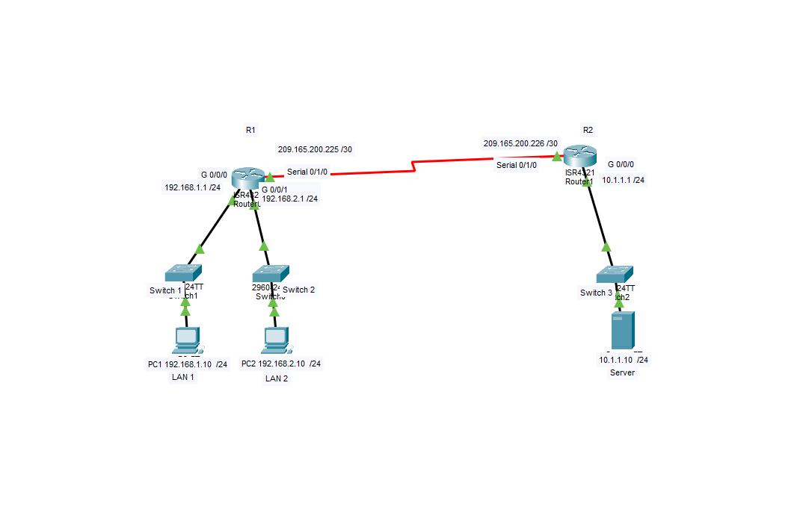

# Extended ACL Access Control

## Overview

This lab demonstrates the configuration and use of Cisco Extended Access Control Lists (ACLs) to control traffic between network segments.

Using Cisco Packet Tracer, I configured two routers, three switches, two client PCs and a server. I then implemented numbered and named extended ACLs to restrict access to specific network services.

[Download the Packet Tracer Template](lab.pkt)

## Network Topology



The network consists of:

- Two routers (R1 and R2)
- Three switches
- Two client PCs (PC1 and PC2)
- One server

### IP Addressing

| Device | Interface | IP Address |
|---|---|---|
| R1 | G0/0/0 | 192.168.1.1/24 |
| R1 | G0/0/1 | 192.168.2.1/24 |
| R1 | S0/1/0 | 209.165.200.225/30 |
| R2 | G0/0/0 | 10.1.1.1/24 |
| R2 | S0/1/0 | 209.165.200.226/30 |
| Server | NIC | 10.1.1.10/24 |
| PC1 | NIC | 192.168.1.10/24 |
| PC2 | NIC | 192.168.2.10/24 |

## Access Control Requirements

The objective was to enforce different access permissions for the two client networks.

| Source | Destination | Service | Action |
|---|---|---|---|
| 192.168.1.0/24 | 10.1.1.10 | FTP (TCP 21) | Permit |
| 192.168.1.0/24 | 10.1.1.10 | ICMP | Permit |
| 192.168.2.0/24 | 10.1.1.10 | HTTP (TCP 80) | Permit |
| 192.168.2.0/24 | 10.1.1.10 | ICMP | Permit |
| 192.168.2.0/24 | 10.1.1.10 | FTP (TCP 21) | Deny |

Traffic not explicitly permitted is subject to the implicit deny at the end of each ACL.

## Configuration

Two extended ACLs were configured on R1.

### 1. Numbered Extended ACL 100

ACL 100 controls traffic entering R1 through interface G0/0/0 from the 192.168.1.0/24 network.

```cisco
access-list 100 permit tcp 192.168.1.0 0.0.0.255 host 10.1.1.10 eq ftp
access-list 100 permit icmp 192.168.1.0 0.0.0.255 host 10.1.1.10

int g0/0/0
 ip access-group 100 in
```
### 2. Named Extended ACL: HTTP_ONLY

ACL `HTTP_ONLY` controls traffic entering R1 through interface G0/0/1 from the 192.168.2.0/24 network.

```cisco
ip access-list extended HTTP_ONLY
 permit tcp 192.168.2.0 0.0.0.255 host 10.1.1.10 eq www
 permit icmp 192.168.2.0 0.0.0.255 host 10.1.1.10

int g0/0/1
 ip access-group HTTP_ONLY in
```
